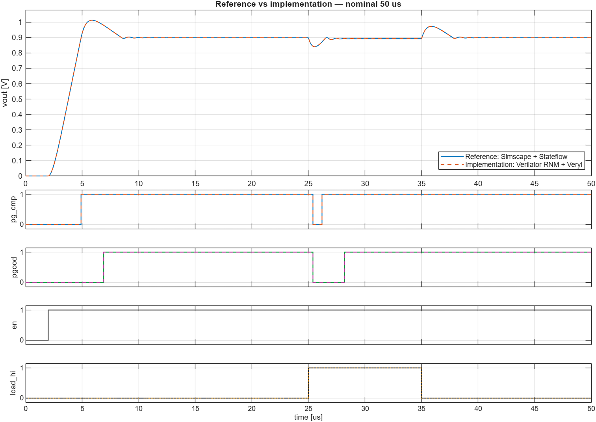

RTLを語る会 #19 用のデモです。

1. LDOモデル作成：MATLAB / Simulink
2. PGOOD監視ロジックのモデル作成：MATLAB / Stateflow
3. PGOOD監視ロジックのRTL生成：Veryl
4. APBレジスタのRTL生成：RgGen
5. LDOモデル作成：SV-RNM
6. SV-RNMとRTLを統合してシミュレーション：Verilator
7. MATLABとVerilatorの波形比較：MATLAB / Simulation Data Inspector

